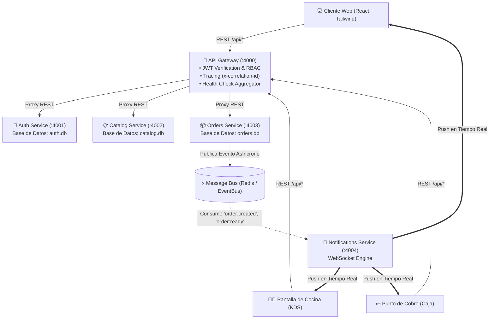
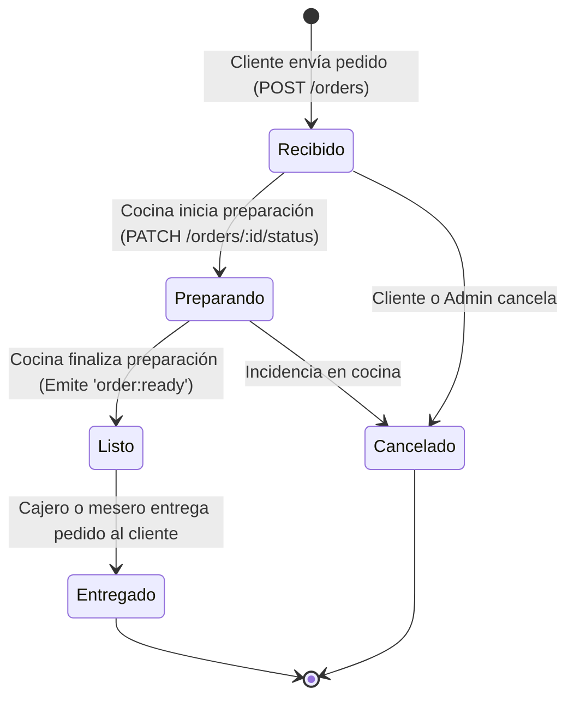

# ☕ Sistema de Pedidos para una Cafetería
### Arquitectura de Microservicios para Aplicaciones Web

---

## 📌 1. Planteamiento del Problema

Una cafetería con servicio en local (mesas) y para llevar busca digitalizar su proceso de pedidos. Actualmente todo se anota en papel y se pierden pedidos en horas pico. 

Este proyecto implementa una solución completa basada en una **Arquitectura de Microservicios** donde:
1. **Los Clientes** exploran el catálogo digital, personalizan su orden (en local o para llevar) y siguen el progreso de su pedido en tiempo real.
2. **La Cocina** gestiona la cola de preparación en tiempo real mediante un Kitchen Display System (KDS) interactivo con alertas sonoras.
3. **El Cajero** administra el cobro simulado (efectivo con cálculo de cambio, tarjeta o transferencia), emite tickets de compra y consulta reportes financieros diarios.
4. **La Administración** controla el catálogo de productos, categorías y disponibilidad en tiempo real.

---

## 🏛️ 2. Arquitectura del Sistema

El sistema implementa los patrones fundamentales de la ingeniería de microservicios:
- **Database-per-Service**: Cada servicio posee su propia base de datos aislada e independiente (`auth.db`, `catalog.db`, `orders.db`).
- **API Gateway Centralizado**: Punto único de entrada inverso que centraliza la autenticación JWT, verificación de roles (RBAC), agregación de métricas de salud y propagación de trazas (`x-correlation-id`).
- **Comunicación Híbrida Síncrona / Asíncrona**:
  - **Síncrona (REST)**: Entre clientes, API Gateway y microservicios para operaciones de lectura/escritura inmediata.
  - **Asíncrona (Message Bus / Event-Driven)**: Publicación y suscripción a eventos de dominio (`order:created`, `order:status_updated`, `order:ready`, `order:paid`) mediante un bus de mensajes (Redis Pub/Sub / In-Memory).
- **Tiempo Real (WebSocket)**: Socket.IO con salas segmentadas (`kitchen`, `cashier`, `customer:<id>`, `order:<id>`).



---

## 🧩 3. Microservicios del Ecosistema

| Microservicio | Puerto | Protocolo | Base de Datos | Responsabilidad |
|---|---|---|---|---|
| **API Gateway** | `4000` | HTTP / REST | N/A | Enrutamiento inverso, guardias de rol, tokens JWT, observabilidad. |
| **Auth & Users** | `4001` | HTTP / REST | SQLite (`auth.db`) | Registro, login, hashing con bcrypt y emisión de tokens JWT. |
| **Catalog** | `4002` | HTTP / REST | SQLite (`catalog.db`) | CRUD de productos, categorías, precios y switch de disponibilidad. |
| **Orders** | `4003` | HTTP / REST + Eventos | SQLite (`orders.db`) | Ciclo de vida del pedido, cobro simulado, cálculo de IVA y reportes. |
| **Notifications**| `4004` | WebSocket (Socket.IO) / REST | Event Bus | Distribución de notificaciones y alertas en tiempo real. |
| **Frontend Web** | `5173` / `3000` | HTTP / WS | N/A | SPA en React con Tailwind CSS y paneles especializados. |

---

## 🔄 4. Flujo de Estados del Pedido (State Machine)



---

## 🔑 5. Cuentas de Acceso Rápido (Demo)

El sistema incluye 4 cuentas precargadas en la base de datos para pruebas inmediatas (disponibles con 1 clic en el selector del encabezado o modal de autenticación):

| Rol | Correo Electrónico | Contraseña | Panel Recomendado |
|---|---|---|---|
| **Cliente** | `cliente@cafeteria.com` | `cliente123` | Menú & Pedidos (Explorador, Carrito, Seguimiento) |
| **Cocina** | `cocina@cafeteria.com` | `cocina123` | Cocina KDS (Cola en tiempo real, Cambio de estado) |
| **Cajero** | `cajero@cafeteria.com` | `cajero123` | Caja (Cobro simulado, Emisión de tickets, Reportes) |
| **Administrador** | `admin@cafeteria.com` | `admin123` | Admin Catálogo (CRUD de productos y disponibilidad) |

---

## 🚀 6. Instrucciones de Ejecución

### Opción A: Ejecución Local Rápida (Recomendada)

Requisitos: Node.js (v18+)

1. **Instalar dependencias y sembrar datos:**
   ```bash
   npm install
   npm run seed
   ```

2. **Iniciar todos los microservicios y el frontend con un solo comando:**
   ```bash
   npm run dev
   ```

3. **Abrir en el navegador:**
   - **Frontend:** [http://localhost:5173](http://localhost:5173)
   - **API Gateway:** [http://localhost:4000](http://localhost:4000)
   - **Health Check Global:** [http://localhost:4000/health](http://localhost:4000/health)

---

### Opción B: Ejecución con Docker & Docker Compose

Requisitos: Docker y Docker Compose

1. **Construir y levantar todos los contenedores:**
   ```bash
   docker compose up --build
   ```

2. **Acceso:**
   - **Frontend (Nginx):** [http://localhost:3000](http://localhost:3000)
   - **API Gateway:** [http://localhost:4000](http://localhost:4000)
   - **Redis Message Broker:** `localhost:6379`

---

## 🧪 7. Pruebas Automatizadas

El proyecto incluye 27 pruebas unitarias, de integración y de contrato cubriendo:
- Autenticación, JWT, roles y rechazo de contraseñas inválidas.
- Catálogo: listado, filtros, creación, toggle de disponibilidad y eliminación.
- Pedidos: cálculo de subtotal, IVA (16%), total, máquina de estados y validación de transiciones ilegales.
- Cobro: cálculo de cambio en efectivo y reportes diarios.
- API Gateway: inyección de trazas `x-correlation-id`, chequeo de salud y guardias RBAC (401 / 403).

Para ejecutar la suite de pruebas:
```bash
npm test
```

---

## 📡 8. Documentación de Endpoints (API Gateway)

### 🔐 Autenticación (`/api/auth`)
- `POST /api/auth/register`: Registro de usuario (`{ name, email, password, role }`).
- `POST /api/auth/login`: Autenticación y entrega de token JWT (`{ email, password }`).
- `GET /api/auth/profile`: Consulta de perfil activo con token Bearer.
- `GET /api/auth/health`: Estado del servicio.

### 📋 Catálogo (`/api/catalog`)
- `GET /api/catalog/products`: Listado de productos (parámetros: `category_id`, `search`, `available_only`).
- `GET /api/catalog/products/:id`: Detalle de producto por ID.
- `POST /api/catalog/products`: Creación de producto *(Requiere rol `admin` o `cajero`)*.
- `PUT /api/catalog/products/:id`: Edición de producto.
- `PATCH /api/catalog/products/:id/availability`: Toggle de disponibilidad *(Disponible/Agotado)*.
- `DELETE /api/catalog/products/:id`: Eliminación de producto *(Requiere rol `admin`)*.
- `GET /api/catalog/categories`: Listado de categorías.
- `POST /api/catalog/categories`: Creación de categoría.

### 📦 Pedidos & Reportes (`/api/orders`)
- `POST /api/orders`: Crea un nuevo pedido con cálculo de totales y emisión de `order:created`.
- `GET /api/orders`: Listado con filtros (`status`, `payment_status`, `order_type`, `date`).
- `GET /api/orders/:id`: Detalle completo con ítems, historial de estados y comprobante de pago.
- `PATCH /api/orders/:id/status`: Avanza estado del pedido *(Requiere rol `cocina`, `cajero` o `admin`)*.
- `POST /api/orders/:id/pay`: Procesa cobro simulado (Efectivo/Tarjeta/Transferencia) y genera recibo *(Requiere rol `cajero` o `admin`)*.
- `GET /api/orders/reports/daily`: Reporte financiero diario con KPIs, top productos y desglose de pago.
- `GET /api/orders/customer/:customerId`: Historial de pedidos de un cliente.

### 🔔 Notificaciones & Observabilidad
- `GET /health`: Health check agregador que inspecciona todos los microservicios en paralelo.
- `GET /api/notifications/recent`: Últimos eventos emitidos (fallback para polling).
- `GET /api/notifications/sse`: Stream Server-Sent Events (SSE).
- `WS /socket.io`: Conexión WebSocket para eventos en tiempo real.

---

## 👥 Roles y Permisos (RBAC)

| Funcionalidad | Cliente | Cocina | Cajero | Administrador |
|---|:---:|:---:|:---:|:---:|
| Explorar catálogo y realizar pedido | ✅ | ✅ | ✅ | ✅ |
| Seguimiento en vivo de su propio pedido | ✅ | ✅ | ✅ | ✅ |
| Ver cola en tiempo real (Display KDS) | ❌ | ✅ | ✅ | ✅ |
| Cambiar estado de preparación | ❌ | ✅ | ✅ | ✅ |
| Cobrar pedidos y emitir tickets | ❌ | ❌ | ✅ | ✅ |
| Ver Reportes Financieros de Venta | ❌ | ❌ | ✅ | ✅ |
| Crear / Editar / Eliminar en Catálogo | ❌ | ❌ | ❌ | ✅ |
| Consultar Dashboard de Microservicios | ✅ | ✅ | ✅ | ✅ |
